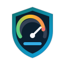
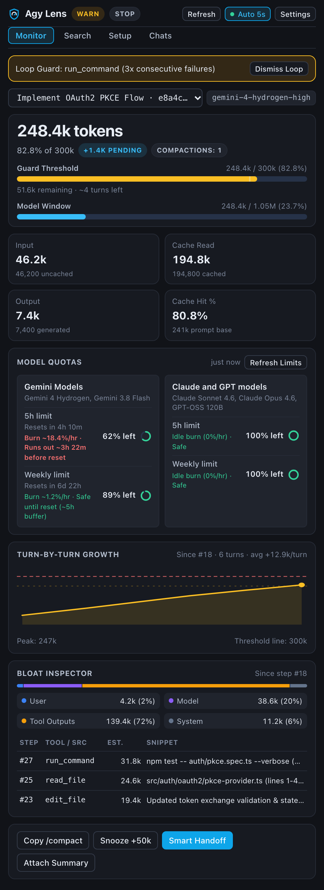
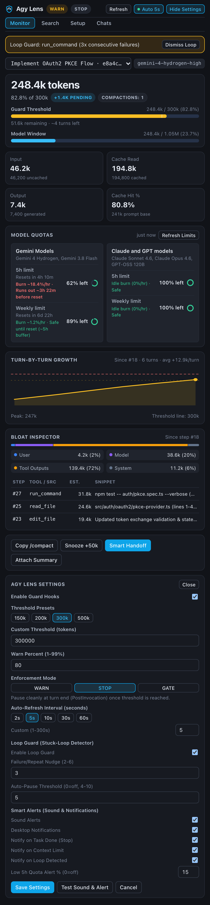
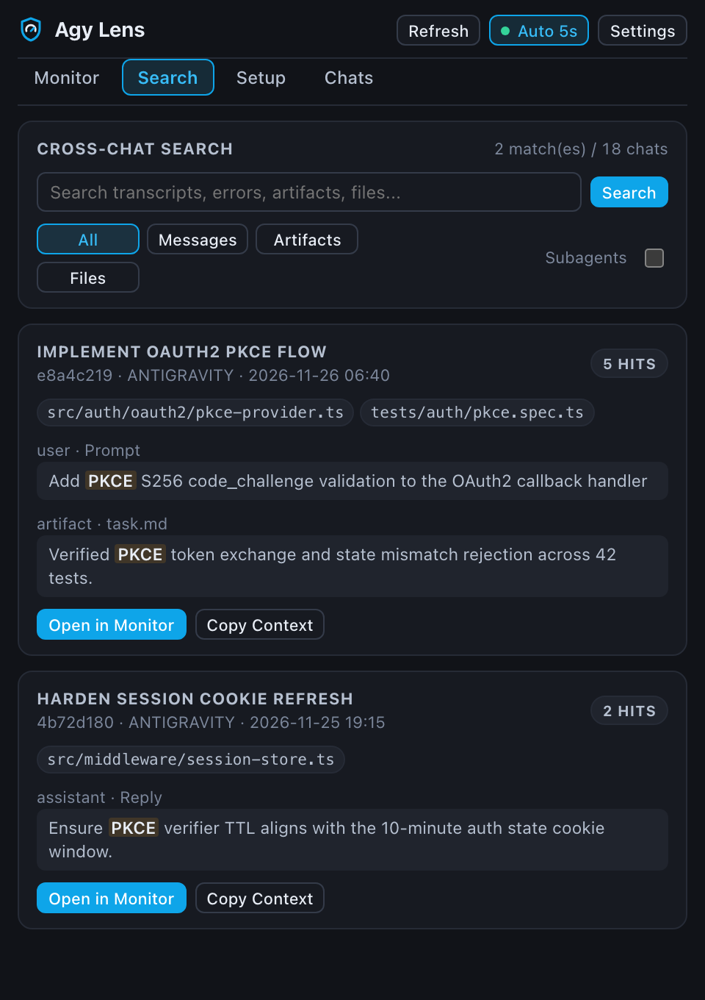
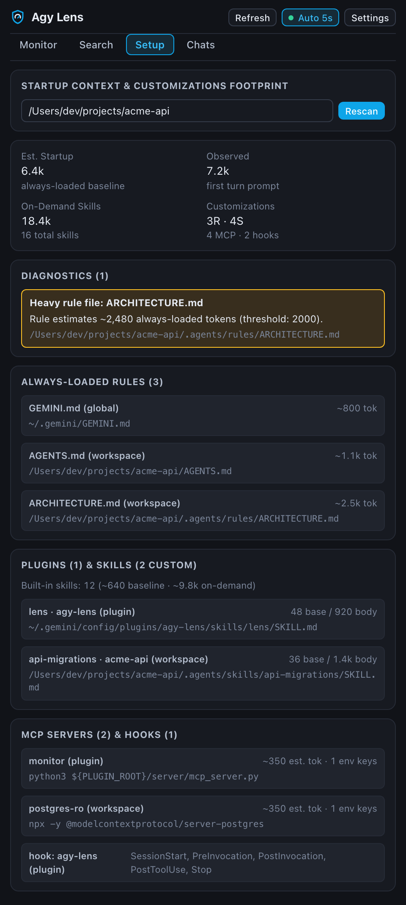
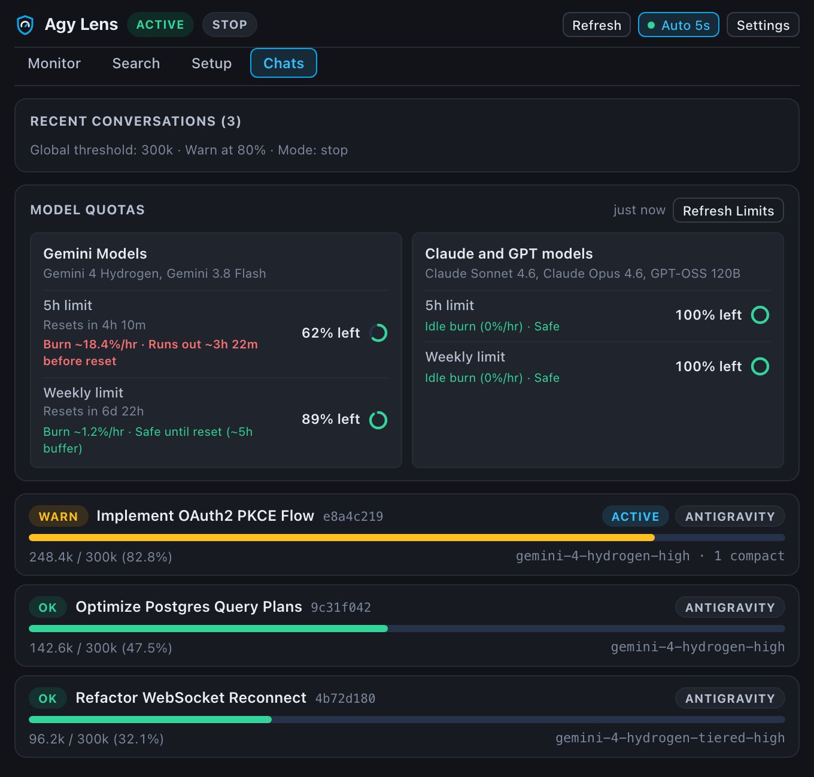

# Agy Lens (`agy-lens`)

<p align="left">
  
</p>

All-in-one observability and guardrails cockpit for **Antigravity** (Desktop App, CLI `agy`, and IDE) combining real-time context window monitoring, model quota burn-rate prediction, cross-chat full-text search, startup customization token footprint inspection, stuck-loop detection, and smart desktop/sound alerts.

> **Upgrading from `agy-context-guard` (`v1.x`)?** Your `~/.gemini/config/context-guard.json` settings and quota cache automatically migrate to `~/.gemini/config/agy-lens.json`, and all legacy `context_*` MCP tool names remain supported. Uninstall the old plugin (`agy plugin uninstall agy-context-guard`) before installing `agy-lens` so duplicate hooks do not run twice.

---

## Screenshots *(Example Data)*

### Monitor Tab & Context Guardrails + Quota Burn-Rate + Loop Guard Banner
| Monitor Tab (`context_status`) | Settings Drawer (`Loop Guard` & `Smart Alerts`) |
|---|---|
|  |  |

### Cross-Chat Search, Startup Setup Footprint & Multi-Chat Overview
| Cross-Chat Full-Text Search (`Search`) | Startup Customizations Footprint (`Setup`) |
|---|---|
|  |  |

| Multi-Conversation Overview (`Chats` / `context_overview`) |
|---|
|  |

---

## Features

### 1. Context Window Telemetry, Epoch Sparklines & Bloat Inspector (`Monitor`)
- **Exact Per-Turn Token Math:** Reads `input_tokens + cache_read_tokens + output_tokens` from `transcript.jsonl` plus pending post-response delta estimates (`+PENDING`), cache hit %, and remaining estimated turns.
- **Compaction-Aware Epoch Tracking:** Automatically detects compactions (`>= 35%` prompt-token drop, `<CONTEXT_SUMMARY>`, or `CHECKPOINT`), scopes **Turn-by-Turn Growth** and **Bloat Inspector** strictly to the active epoch (`Since #<step>`), and ranks the top-8 heaviest tool outputs.
- **Threshold Guardrails & Recovery:** Supports **Warn**, **Stop**, and **Gate** enforcement modes, `+50k` snooze, one-click **Copy `/compact`**, and **Smart Handoff** to launch a continuation brief in a new chat.

### 2. Model Quotas + Burn-Rate & Reset Predictor (`Model Quotas` card)
- **Non-Blocking Live Tracker:** Uses `agy -p /usage --output-format json` via UI refresh or throttled (`>= 300s`) detached background refresh on idle `Stop` hooks.
- **Rolling 7-Day Quota History (`agy-lens-quota-history.json`):** Isolates the current reset window and computes **`%/hr` burn rate**, **estimated time until exhaustion**, and risk classification:
  - `at_risk`: predicted to run out before window reset
  - `tight`: tight headroom margin before reset
  - `safe` / `idle` / `warming`

### 3. Cross-Chat Full-Text Search (`Search` tab / `lens_search`)
- **`mtime`-Cached Indexer (`agy-lens-search-cache.json`):** Searches all local Antigravity conversation transcripts (`transcript.jsonl`), markdown artifacts (`*.md`), and edited file paths.
- **Rich Query & Action Support:** Multi-term `AND` queries, quoted exact phrases (`"pkce verifier"`), scope filters (**All**, **Messages**, **Artifacts**, **Files**), subagent inclusion toggle, `<mark>` highlighted snippets, **Open in Monitor**, and **Copy Context**.

### 4. Startup Context & Customizations Footprint (`Setup` tab / `lens_footprint`)
- **Full Customization Discovery:** Scans documented global (`~/.gemini/`, `~/.agents/`, `~/.gemini/config/config.json`, `skills.json`) and `.git`-bounded workspace hierarchies for:
  - **Always-Loaded Rules** (`GEMINI.md`, `AGENTS.md`, `.agents/rules/*.md`, `rules.json`)
  - **Plugins & Skills** (respecting disabled plugin state and separating always-loaded YAML frontmatter tokens from on-demand `SKILL.md` bodies; built-in skills aggregated cleanly)
  - **MCP Servers** (strictly masking all `env` values, auth headers, flags, and URL credentials while showing key counts and sanitized command previews)
  - **Lifecycle Hooks** (`hooks.json`)
- **Actionable Diagnostics:** Compares estimated baseline startup overhead against your active chat's observed first-turn prompt tokens (`firstTurnTokens`) and flags `duplicate_plugin`, `rule_heavy`, `skill_override`, and `high_mcp_count`.

### 5. Stuck-Loop Detector & Smart Sound/Desktop Alerts (`hooks.json` + Settings)
- **Silent Streak Detection (`PostToolUse`):** Detects consecutive identical tool failures (`>= 3`, configurable `2–6`) or identical tool repeats (`threshold + 1`) and automatically clears when another tool makes progress.
- **Recoverable Nudge & Auto-Pause (`PreInvocation` / `PostInvocation`):** Injects a one-time loop-break nudge (`nudgeOncePerStreak`) and optional recoverable `autoPauseThreshold` (`0` = off, or `4–10`), automatically unlocking when you change prompts, dismiss the Monitor banner (`Dismiss Loop`), or run bypass commands (`/compact`, `agy-lens`).
- **Non-Blocking OS Alerts (`lens_guard.py`):** Detached macOS (`afplay` + `osascript`) and Linux (`notify-send`) notifications with configurable per-event toggles (`Stop`, context threshold cross, loop detected, low 5h quota `<= 15%`), cooldown throttling, and a **Test Sound & Alert** button in Settings.

---

## Zero-Runtime-Dependency Architecture

End users need **zero** `npm install` or `pip install` steps at runtime:

- **Pure Python 3.9+ Stdlib Backend:** All modules (`scripts/context_core.py`, `scripts/lens_quota.py`, `scripts/lens_search.py`, `scripts/lens_footprint.py`, `scripts/lens_guard.py`, `scripts/hook.py`, `server/mcp_server.py`) use exclusively the Python standard library with cross-process `fcntl.flock` locking and atomic `os.replace` writes.
- **Pre-Bundled Single-File MCP App UI:** `ui/app.html` (`< 512 KiB`) is compiled from TypeScript (`ui-src/`) with inline CSS/JS and zero external network tags (`default-src 'none'` strict CSP).

```text
agy-lens/
├── plugin.json                    # Manifest (name: agy-lens, displayName: Agy Lens)
├── mcp_config.json                # Launches python3 ${PLUGIN_ROOT}/server/mcp_server.py
├── hooks.json                     # SessionStart, PreInvocation, PostInvocation, PostToolUse, Stop
├── scripts/
│   ├── context_core.py            # Transcript analyzer, epoch history, locked JSON store & migration
│   ├── lens_quota.py              # Quota burn-rate predictor, 7d history buffer & background worker
│   ├── lens_search.py             # Mtime-cached cross-chat transcript & artifact full-text search
│   ├── lens_footprint.py          # Rules, skills, plugins, masked MCPs & hooks footprint inspector
│   ├── lens_guard.py              # Stuck-loop detector & detached sound/desktop alert engine
│   └── hook.py                    # Fail-open lifecycle hook entrypoint
├── server/mcp_server.py           # Zero-dep stdio JSON-RPC 2.0 MCP server
├── skills/lens/SKILL.md           # /lens skill reference
├── ui/app.html                    # Pre-bundled 4-tab MCP App UI
├── ui-src/                        # Dev-only TypeScript source, esbuild bundler & Node UI tests
├── assets/                        # Logo SVG & documentation screenshots
└── tests/                         # Python unittest suites
```

---

## Installation

```bash
# If upgrading from v1.x (agy-context-guard):
agy plugin uninstall agy-context-guard

# Install local checkout:
agy plugin install .
agy plugin validate --strict --json .
```

## Configuration (`~/.gemini/config/agy-lens.json`)

Overridable via `AGY_LENS_CONFIG_PATH` (legacy `CONTEXT_GUARD_CONFIG_PATH` and `~/.gemini/config/context-guard.json` are automatically read and migrated if `agy-lens.json` does not exist yet):

- **Core Guard:** `enabled`, `thresholdTokens` (`300000`), `warnPercent` (`80`), `mode` (`"warn" | "stop" | "gate"`), `autoRefreshSeconds` (`5`, range `1–300`).
- **Loop Guard (`loopGuard`):** `enabled` (`true`), `consecutiveThreshold` (`3`, range `2–6`), `nudgeOncePerStreak` (`true`), `autoPauseThreshold` (`5`, `0` disables or `4–10`).
- **Smart Alerts (`alerts`):** `soundEnabled` (`true`), `desktopNotificationEnabled` (`true`), `notifyOnStop` (`true`), `notifyOnThreshold` (`true`), `notifyOnLoop` (`true`), `notifyOnLowQuotaPct` (`15`, range `0–50`), `cooldownSeconds` (`15`).

## MCP Tools

- **Model + UI Tools:** `context_status`, `context_overview`, `context_configure`, `context_handoff`, `lens_search`, `lens_footprint`
- **Internal UI Tools:** `app_refresh`, `app_save_settings`, `app_snooze`, `app_build_handoff`, `app_quota`, `app_search`, `app_footprint`, `app_clear_loop`, `app_test_alert`

## Development & Verification

```bash
cd ui-src && npm install && npm run typecheck && npm run build && npm test
cd .. && python3 -W error -m unittest discover -s tests -v
agy plugin validate --strict --json .
```

## License

MIT
